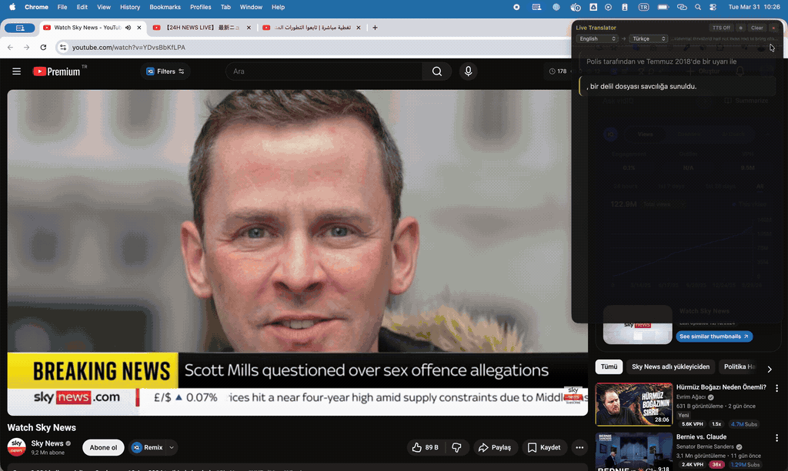

<p align="center">
  <strong>English</strong> · <a href="README.tr.md">Türkçe</a>
</p>

<p align="center">
  
</p>

<h1 align="center">Live Translator</h1>

<p align="center">
  <strong>Free, private, real-time translation for any audio on your Mac.</strong><br>
  YouTube, podcasts, meetings, movies: see the translation live on screen and hear it read aloud.<br>
  No account. No API key. Translation and voice run on your Mac.
</p>

<p align="center">
  <a href="https://github.com/umutcetinkaya/live-translator/releases/latest"></a>
  
  
  <a href="https://github.com/umutcetinkaya/live-translator/stargazers"></a>
  
  <a href="LICENSE"></a>
</p>

<p align="center">
  <a href="https://github.com/umutcetinkaya/live-translator/releases/latest/download/LiveTranslator-v0.2.3-macOS.dmg">
    
  </a>
  &nbsp;&nbsp;
  <a href="https://buymeacoffee.com/umutcetinkaya">
    
  </a>
</p>

<p align="center">
  <a href="WHATS-NEW.md"><strong>New in v0.2.0: completely free and on-device →</strong></a>
</p>

---

## Free. Private. Spoken.

| | |
|---|---|
| 🆓 **Free** | No subscription, no account, no API key, no usage limits. Install it and it works. |
| 🔒 **Private** | Translation and voice run on your Mac; nothing is sent to an AI company. Speech recognition runs on-device too, for every language whose dictation model is installed ([how](#on-device-speech-recognition)). |
| 🔊 **Spoken** | Translations are read aloud with your Mac's own voices, so you can listen instead of read. |
| ✈️ **Works offline** | After a one-time model download, no internet is needed for languages recognised on-device. |

Want the big cloud models instead? Plug in your own OpenAI, Google Gemini or Anthropic key at any time. Free stays the default.

## Why?

You're watching a YouTube video in Japanese. A podcast in Arabic. A meeting in German. You don't speak these languages, but you want to understand **everything**, **right now**.

Live Translator sits quietly in your menu bar, captures whatever audio your Mac is playing, and shows a live, flowing translation on screen, read aloud if you like. No copy-pasting, no tab switching, no waiting. Just play audio.

```
System Audio  →  Speech Recognition  →  Translation              →  Overlay + Voice
(ScreenCaptureKit) (Apple, on-device     (on your Mac, or your       (WebKit panel,
                    where available)     own cloud provider)         macOS voices)
```

## Demo

### 🇯🇵 Japanese → 🇹🇷 Turkish


### 🇬🇧 English → 🇹🇷 Turkish


### 🇸🇦 Arabic → 🇹🇷 Turkish


### 🇸🇦 Arabic → Multi Language


## Features

- **Free & on-device by default**: translation runs on [TranslateGemma](https://huggingface.co/collections/google/translategemma), Google's open translation model, right on your Mac
- **Read aloud**: translations are spoken with free macOS voices; Piper, OpenAI and Gemini voices are available too
- **Real-time translation** of any audio on your Mac
- **14 source languages**: English, German, French, Spanish, Italian, Japanese, Chinese, Korean, Russian, Arabic, Portuguese, Turkish, Dutch, Polish
- **14 target languages**: translate into any supported language
- **Sentence by sentence**: each finished sentence is translated once and stays put, so long sessions stay fast
- **Bring your own key (optional)**: OpenAI, Google Gemini or Anthropic Claude for cloud translation
- **Floating overlay**: dark-themed panel, draggable, always on top, with live voice controls
- **In-app settings**: provider, model, voice, languages, all from the UI
- **No audio drivers needed**: uses ScreenCaptureKit (macOS 13+)
- **Optional realtime mode**: lower latency via OpenAI's Realtime Translation model; audio is streamed to the provider
- **Auto-recovery**: a watchdog detects and recovers from stuck states
- **Menu bar app**: runs quietly with a 🌐 icon
- **Update notice**: when a new release is out, the 🌐 menu shows it

## What's new in v0.2

**v0.2.3** adds Turkish, Dutch and Polish as spoken languages (Dutch and Polish as targets too) and tells you in the 🌐 menu when a new version is available.

**v0.2.2** moves OpenAI voices to the Realtime API before OpenAI's older speech models shut down on January 6, 2027. Your saved voice moves to its closest match.

**v0.2.1** brings the cloud models up to date (GPT-6, Gemini 3.x, Claude 5.5) before older ones shut down, and keeps the tier you picked when your model is replaced.

**v0.2.0:**

- **Completely free out of the box.** No API key needed: translation runs on your Mac with TranslateGemma, and translations are read aloud with macOS voices.
- **Picked for accuracy.** The on-device model was chosen by testing what usually goes wrong: weekdays, times, numbers and negations.
- **Model matched to your Mac.** 8 GB, 16 GB and 32 GB Macs each get a model that fits, with an opt-in larger one for the best accuracy.
- **Your settings are kept.** Already using an API key? Nothing changes until you switch.

Read the full story in **[What's new](WHATS-NEW.md)**, or every change in the **[changelog](CHANGELOG.md)**.

## Install

### Option 1: DMG (Recommended)

<a href="https://github.com/umutcetinkaya/live-translator/releases/latest/download/LiveTranslator-v0.2.3-macOS.dmg">
  
</a>

1. Download → Open DMG → Drag to **Applications**
2. Launch → Setup wizard guides you through everything
3. Pick **Free · On-device** (recommended), or enter your own [OpenAI](https://platform.openai.com) API key. [Gemini](https://aistudio.google.com/apikey) and [Anthropic](https://console.anthropic.com) keys can be added later in Settings
4. Grant **Screen & System Audio Recording** permission when prompted
5. Play any audio → translations appear live and are read aloud

The app is signed and notarized by Apple, so it opens without a security warning.

### Option 2: Homebrew

```bash
brew tap umutcetinkaya/tap
brew install --cask live-translator
```

### Option 3: From Source

```bash
git clone https://github.com/umutcetinkaya/live-translator.git
cd live-translator
make install    # Create venv + install deps
make run        # Launch
```

## Free mode

Out of the box, Live Translator needs nothing but your Mac:

- **Translation** runs on [TranslateGemma](https://huggingface.co/collections/google/translategemma), Google's open translation model, through [MLX](https://github.com/ml-explore/mlx), Apple's framework for Apple Silicon. It downloads once in the background on first launch; the panel shows the progress.
- **Speech** uses the voices built into macOS, so translations are read aloud instantly, in every supported language.

| Model | Used by default on | Download | Memory | Speed (M5 Pro) | Accuracy check |
|-------|--------------------|----------|--------|----------------|----------------|
| **Small**: [TranslateGemma 4B, 4-bit](https://huggingface.co/mlx-community/translategemma-4b-it-4bit) | 8 GB Macs | 2.2 GB | ~2.5 GB | ~0.4 s per sentence | 9 of 12 |
| **Standard**: [TranslateGemma 4B, 8-bit](https://huggingface.co/mlx-community/translategemma-4b-it-8bit) | 16 GB or more | 4.2 GB | ~4.4 GB | ~0.6 s per sentence | 11 of 12 |
| **Large**: [TranslateGemma 12B, 4-bit](https://huggingface.co/mlx-community/translategemma-12b-it-4bit) | opt-in, 32 GB or more | 6.7 GB | ~7 GB | ~1 s per sentence | 12 of 12 |

You can switch models, or delete a downloaded one, in **Settings**. The accuracy check is `scripts/bench_local_models.py`: sentences where a wrong translation is easy to miss (weekdays, times, numbers, negations), including unpunctuated text the way speech recognition delivers it, from English, Japanese and Arabic. The scores above are from the first 12 sentences; Spanish sentences were added later. In those tests the small model got weekdays wrong in unpunctuated text where the 8-bit one did not, which is why Macs with enough memory get the 8-bit model. General chat models of the same size (Qwen3 4B and 8B, Gemma 3 4B) were tried first and regularly turned "Thursday" into the wrong day in Turkish, so the free mode uses a dedicated translation model instead.

TranslateGemma is released by Google under the [Gemma Terms of Use](https://ai.google.dev/gemma/terms); it is downloaded from Hugging Face on first use, not bundled with the app.

Free mode needs **Apple Silicon (M1 or later) and macOS 14 or later**. On Intel Macs the setup wizard asks for an API key instead.

### On-device speech recognition

Live Translator uses Apple's speech recognition and asks for it to run on-device whenever your Mac has the dictation model for that language. English usually does. For other languages, the model is downloaded when you add the language under **System Settings › Keyboard › Dictation**. Until then, Apple's speech service recognises that language over the internet, the same way Siri dictation does. Translation and voice stay on your Mac either way.

### Better voices

macOS ships a basic voice per language. For a much more natural one, open **System Settings › Accessibility › Spoken Content › System Voice › Manage Voices** and download an *Enhanced* or *Premium* voice for your target language. Live Translator picks the best installed voice automatically, or choose one in Settings.

## Quick Start

1. Launch → floating panel appears + 🌐 in menu bar
2. Select the **source language** (what's being spoken) and the **target language** (what you want to read and hear)
3. Play any audio → translations appear in real time and are read aloud
4. The first time, wait for the translation model to download; the panel shows the progress
5. Open **⚙ Settings** to change the model or voice, or to add your own API key

### Controls

| Control | Action |
|---------|--------|
| Source / Target dropdowns | Change languages |
| 🔊 Voice, provider, volume | Live voice controls above the translation |
| ⚙ Settings | Provider, model, voice, API keys |
| TTS Off / On | Toggle text-to-speech (remembered between launches) |
| Clear | Reset translation history |
| ✕ | Quit |
| Menu bar 🌐 | Pause, Show/Hide, Quit |

## Text-to-Speech

| Provider | Pros | Cons |
|----------|------|------|
| **System voice** (default) | Free, offline, instant, every language; natural with Enhanced/Premium voices | Basic voices sound flat until you download a better one |
| **Piper** | Free, offline, fast | Robotic voice; downloads the voice for your language on first use |
| **OpenAI** | Natural voices through the Realtime API (Marin and Cedar recommended, 8 more) | Costs money; speeds above 1.5x are capped |
| **Gemini TTS** | Natural voices via Gemini | Costs money |

Spoken translations are loudness-normalised so they stay audible over the source; to make the source quieter, turn it down in your player. The app's own voice is filtered out of the capture, so there are no feedback loops.

## Cloud providers (optional)

Prefer a cloud model? Pick a provider in Settings, paste its API key, and the model list updates automatically. You pay the provider directly; Live Translator itself stays free.

**OpenAI**

| Model | Speed | Cost | Best For |
|-------|-------|------|----------|
| GPT-6 Luna | ⚡ Fastest | ¢ | Daily use (default) |
| GPT-6.1 Terra | ⚡ Fast | $ | Balanced |
| GPT-6.2 Sol | 🚀 Fast | $$ | Higher quality |

**Google Gemini**

| Model | Speed | Cost | Best For |
|-------|-------|------|----------|
| Gemini 3.5 Flash-Lite | ⚡ Fastest | ¢ | Daily use (default) |
| Gemini 3.6 Flash | ⚡ Fast | $ | Balanced |
| Gemini 3.8 Flash | 🚀 Fast | $$ | Higher quality |

**Anthropic Claude**

| Model | Speed | Cost | Best For |
|-------|-------|------|----------|
| Claude Haiku 5.5 | ⚡ Fastest | ¢ | Daily use (default) |
| Claude Sonnet 5.5 | 🚀 Fast | $$ | Higher quality |
| Claude Opus 5.5 | 🐢 Moderate | $$$ | Maximum quality |

> **Upgrading:** if you had picked a model that has since been retired or replaced (for example Gemini 2.5 Flash, which Google shuts down on December 1, 2026), Live Translator moves you to its successor in the same tier automatically.

> **Note:** Claude is text-translation only. Anthropic has no audio API, so realtime mode is unavailable when Claude is selected; on-device speech recognition feeds it instead.

## How It Works

Live Translator runs two independent workers in parallel:

1. **Listener**: captures system audio with ScreenCaptureKit and transcribes it on-device with SFSpeechRecognizer
2. **Translator**: as soon as a sentence is finished, translates just that sentence and appends it. Speech without punctuation is cut into chunks of about 18 words, and a pause in speech flushes whatever is left

Each piece is translated once and then frozen, so a long session never re-sends the whole transcript and the translation never gets truncated. Cloud providers also receive the previous two sentences as read-only context, to resolve pronouns and terminology. The newest translation is highlighted, and with speech on it is read aloud.

### Realtime mode (optional)

By default, audio is recognised with Apple's speech recognition (on-device where available) and only text reaches the translator. For lower latency with a cloud provider you can enable **Realtime mode** in Settings (OpenAI), which streams audio directly to OpenAI's Realtime Translation model and returns the translation as it speaks. This trades privacy for speed: **audio is sent to the provider**. A warning is shown in Settings when you enable it.

## Architecture

```
live-translator/
├── main.py                      # Entry point + menu bar
├── src/
│   ├── audio_capture.py         # ScreenCaptureKit system audio
│   ├── speech_recognizer.py     # SFSpeechRecognizer + watchdog
│   ├── segmenter.py             # Decides when a sentence is finished
│   ├── translator.py            # Sentence-by-sentence translation
│   ├── providers/               # local (MLX) · openai · gemini · claude
│   │                            # system voice · piper · realtime
│   ├── local_models.py          # On-device model tiers
│   ├── model_store.py           # Model download + progress
│   ├── pipeline.py              # Listener + Translator orchestrator
│   ├── overlay.py               # WebKit floating panel (HTML/CSS/JS)
│   ├── tts.py                   # Speech queue, normalisation
│   └── config.py                # JSON settings
├── scripts/
│   ├── build_app.sh             # Build .app bundle
│   ├── build_dmg.sh             # Create DMG installer
│   ├── bench_local_models.py    # Compare on-device models
│   ├── notarize.sh              # Apple notarization
│   ├── setup_wizard.swift       # Native macOS setup wizard
│   └── launcher.c               # Native .app launcher
├── tests/                       # pytest suite
├── assets/                      # App icon + demo media
├── CHANGELOG.md
├── WHATS-NEW.md
├── CONTRIBUTING.md
├── SECURITY.md
└── LICENSE
```

## Configuration

Settings are stored in `~/.live-translator.json` and can be changed from the in-app Settings panel. A fresh install looks like this:

```json
{
  "translation_provider": "local",
  "model": "mlx-community/translategemma-4b-it-8bit",
  "source_locale": "en-US",
  "target_lang": "tr",
  "tts_provider": "system",
  "tts_enabled": true,
  "tts_speed": 1.0,
  "realtime_mode": false,
  "check_for_updates": true,
  "openai_api_key": "",
  "gemini_api_key": "",
  "anthropic_api_key": ""
}
```

Downloaded models live in `~/Library/Application Support/LiveTranslator/models`.

Once per launch the app asks GitHub (`api.github.com`) for the latest release, so it can tell you about updates. Nothing about you or your audio is sent; set `"check_for_updates": false` to turn it off.

## Troubleshooting

| Problem | Solution |
|---------|----------|
| "Damaged and can't be opened" | Download the DMG again from the [releases page](https://github.com/umutcetinkaya/live-translator/releases/latest); versions before 0.2.0 were not notarized |
| No audio detected | Grant Screen & System Audio Recording permission, restart app |
| STT stops working | Built-in watchdog auto-recovers within about 20 seconds |
| Translation not appearing | Free mode: wait for the model download shown in the panel. Cloud providers: check the API key in Settings |
| Model download fails | Check your internet connection and free disk space (up to 4.2 GB, or 6.7 GB for the large model), then press Save in Settings to retry |
| First launch after updating is slow | The app installs its new components once; this can take about a minute |
| Realtime toggle greyed out | Only OpenAI supports realtime; Anthropic has no audio API |
| TTS not working | Check TTS provider in Settings; with System voice, make sure a voice for your target language is installed |
| App not in dock | By design: it's a menu bar app (🌐) |

## Requirements

- **macOS 13 (Ventura)** or later; **free mode: Apple Silicon and macOS 14** or later
- **Python 3.11+** (auto-installed via setup wizard if missing)
- **Free mode:** 2.2 to 4.2 GB of disk for the translation model (6.7 GB for the large one)
- **Optional:** an API key from [OpenAI](https://platform.openai.com), [Google Gemini](https://aistudio.google.com/apikey), or [Anthropic](https://console.anthropic.com) for cloud translation or realtime mode

---

<p align="center">
  <strong>If Live Translator helps you, give it a ⭐ on GitHub. It helps others find it!</strong>
</p>

<p align="center">
  <a href="https://github.com/umutcetinkaya/live-translator">
    
  </a>
</p>

---

## Support the Project

<a href="https://buymeacoffee.com/umutcetinkaya">
  
</a>

## License

MIT, see [LICENSE](LICENSE).

Copyright © 2025 [Umut Çetinkaya](https://umutcetinkaya.com)

## Credits

- [TranslateGemma](https://huggingface.co/collections/google/translategemma) by Google: on-device translation model ([Gemma Terms of Use](https://ai.google.dev/gemma/terms))
- [MLX](https://github.com/ml-explore/mlx) and [mlx-lm](https://github.com/ml-explore/mlx-lm) by Apple: running the model on Apple Silicon
- [ScreenCaptureKit](https://developer.apple.com/documentation/screencapturekit): macOS audio capture
- [SFSpeechRecognizer](https://developer.apple.com/documentation/speech): on-device speech recognition
- [AVSpeechSynthesizer](https://developer.apple.com/documentation/avfaudio/avspeechsynthesizer): macOS system voices
- [Piper TTS](https://github.com/rhasspy/piper): offline text-to-speech
- [OpenAI](https://platform.openai.com), [Google Gemini](https://ai.google.dev) and [Anthropic](https://www.anthropic.com) APIs: optional cloud translation
- [PyObjC](https://pyobjc.readthedocs.io): Python ↔ macOS bridge
