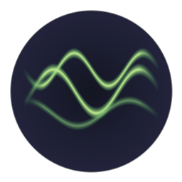
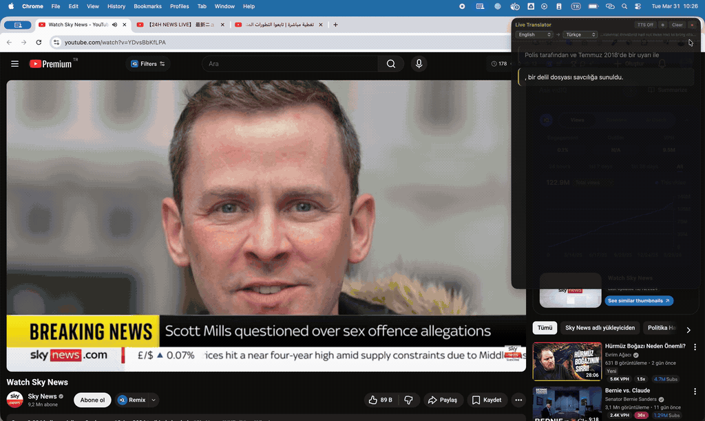

<p align="center">
  <a href="README.md">English</a> · <strong>Türkçe</strong>
</p>

<p align="center">
  
</p>

<h1 align="center">Live Translator</h1>

<p align="center">
  <strong>Mac'inizde çalan her ses için ücretsiz, gizli ve anlık çeviri.</strong><br>
  YouTube, podcast, toplantı, film: çeviriyi ekranda canlı görün, sesli dinleyin.<br>
  Hesap yok. API anahtarı yok. Çeviri ve ses Mac'inizde çalışır.
</p>

<p align="center">
  <a href="https://github.com/umutcetinkaya/live-translator/releases/latest"></a>
  
  
  <a href="https://github.com/umutcetinkaya/live-translator/stargazers"></a>
  
  <a href="LICENSE"></a>
</p>

<p align="center">
  <a href="https://github.com/umutcetinkaya/live-translator/releases/latest/download/LiveTranslator-v0.2.4-macOS.dmg">
    
  </a>
  &nbsp;&nbsp;
  <a href="https://buymeacoffee.com/umutcetinkaya">
    
  </a>
</p>

<p align="center">
  <a href="WHATS-NEW.md"><strong>v0.2.0 ile gelen yenilik: tamamen ücretsiz ve cihaz üzerinde →</strong></a>
</p>

---

## Ücretsiz. Gizli. Sesli.

| | |
|---|---|
| 🆓 **Ücretsiz** | Abonelik yok, hesap yok, API anahtarı yok, kullanım sınırı yok. Kurun, çalışsın. |
| 🔒 **Gizli** | Çeviri ve seslendirme Mac'inizde çalışır; hiçbir şey bir yapay zeka şirketine gönderilmez. Dikte modeli yüklü olan her dilde konuşma tanıma da cihaz üzerinde çalışır ([nasıl](#cihaz-üzerinde-konuşma-tanıma)). |
| 🔊 **Sesli** | Çeviriler Mac'inizin kendi sesleriyle okunur, yani okumak yerine dinleyebilirsiniz. |
| ✈️ **Çevrimdışı çalışır** | Tek seferlik model indirmesinden sonra, cihaz üzerinde tanınan dillerde internete gerek kalmaz. |

Büyük bulut modellerini mi tercih edersiniz? İstediğiniz zaman kendi OpenAI, Google Gemini ya da Anthropic anahtarınızı ekleyebilirsiniz. Varsayılan yine ücretsiz mod olarak kalır.

## Neden?

Japonca bir YouTube videosu izliyorsunuz. Arapça bir podcast dinliyorsunuz. Almanca bir toplantıdasınız. Bu dilleri bilmiyorsunuz ama **her şeyi**, **hemen şimdi** anlamak istiyorsunuz.

Live Translator menü çubuğunda sessizce durur, Mac'inizde çalan sesi yakalar ve ekranda canlı, akan bir çeviri gösterir; isterseniz sesli de okur. Kopyala yapıştır yok, sekme değiştirmek yok, beklemek yok. Sesi açmanız yeterli.

```
Sistem sesi        →  Konuşma tanıma   →  Çeviri                  →  Panel + Seslendirme
(ScreenCaptureKit)    (Apple, mümkünse    (Mac'inizde ya da kendi    (WebKit paneli,
                       cihaz üzerinde)     bulut sağlayıcınızda)      macOS sesleri)
```

## Demo

### 🇯🇵 Japonca → 🇹🇷 Türkçe


### 🇬🇧 İngilizce → 🇹🇷 Türkçe


### 🇸🇦 Arapça → 🇹🇷 Türkçe


### 🇸🇦 Arapça → Birden fazla dil


## Özellikler

- **Varsayılan olarak ücretsiz ve cihaz üzerinde**: çeviri, Google'ın açık çeviri modeli [TranslateGemma](https://huggingface.co/collections/google/translategemma) ile doğrudan Mac'inizde yapılır
- **Sesli okuma**: çeviriler ücretsiz macOS sesleriyle okunur; Piper, OpenAI ve Gemini sesleri de kullanılabilir
- Mac'inizde çalan her sesin **anlık çevirisi**
- **14 kaynak dil**: İngilizce, Almanca, Fransızca, İspanyolca, İtalyanca, Japonca, Çince, Korece, Rusça, Arapça, Portekizce, Türkçe, Hollandaca, Lehçe
- **14 hedef dil**: desteklenen herhangi bir dile çevirin
- **Cümle cümle**: biten her cümle bir kez çevrilir ve öyle kalır, böylece uzun oturumlar da hızlı kalır
- **Kendi anahtarınızı kullanın (isteğe bağlı)**: bulut çevirisi için OpenAI, Google Gemini ya da Anthropic Claude
- **Yüzen panel**: koyu temalı, sürüklenebilir, her zaman üstte, canlı ses kontrolleriyle
- **Uygulama içi ayarlar**: sağlayıcı, model, ses, diller, hepsi arayüzden
- **Ses sürücüsü gerekmez**: ScreenCaptureKit kullanır (macOS 13+)
- **İsteğe bağlı realtime modu**: OpenAI'ın Realtime Translation modeliyle daha düşük gecikme; ses sağlayıcıya aktarılır
- **Otomatik toparlanma**: bir watchdog takılmaları tespit edip düzeltir
- **Menü çubuğu uygulaması**: 🌐 simgesiyle sessizce çalışır
- **Güncelleme bildirimi**: yeni sürüm çıktığında 🌐 menüsünde görünür

## v0.2'de neler yeni

**v0.2.4**, ses seviyesini açılışlar arasında hatırlar ve Ayarlar'ın başka yerde yapılan değişiklikleri geri almasını önler.

**v0.2.3**, Türkçe, Hollandaca ve Lehçeyi konuşulan dil olarak ekler (Hollandaca ve Lehçe hedef dil olarak da gelir) ve yeni bir sürüm çıktığında bunu 🌐 menüsünde gösterir.

**v0.2.2**, OpenAI'ın eski konuşma modelleri 6 Ocak 2027'de kapanmadan önce OpenAI seslerini Realtime API'ye taşır. Kayıtlı sesiniz ona en yakın sese geçer.

**v0.2.1**, eski bulut modelleri kapanmadan önce modelleri günceller (GPT-6, Gemini 3.x, Claude 5.5) ve modeliniz değiştirildiğinde seçtiğiniz seviyeyi korur.

**v0.2.0:**

- **Kurulduğu andan itibaren tamamen ücretsiz.** API anahtarı gerekmez: çeviri TranslateGemma ile Mac'inizde yapılır, çeviriler macOS sesleriyle okunur.
- **Doğruluğa göre seçildi.** Cihaz üzerindeki model, genelde yanlış giden şeyler test edilerek seçildi: haftanın günleri, saatler, sayılar ve olumsuzluklar.
- **Mac'inize uygun model.** 8 GB, 16 GB ve 32 GB Mac'lerin her biri kendine uyan bir model alır; en iyi doğruluk için isteğe bağlı daha büyük bir model de var.
- **Ayarlarınız korunur.** Zaten API anahtarı mı kullanıyorsunuz? Siz değiştirene kadar hiçbir şey değişmez.

Hikayenin tamamı **[What's new](WHATS-NEW.md)** sayfasında, tüm değişiklikler ise **[changelog](CHANGELOG.md)** dosyasında.

## Kurulum

### Seçenek 1: DMG (önerilen)

<a href="https://github.com/umutcetinkaya/live-translator/releases/latest/download/LiveTranslator-v0.2.4-macOS.dmg">
  
</a>

1. İndirin → DMG'yi açın → **Uygulamalar** (Applications) klasörüne sürükleyin
2. Açın → kurulum sihirbazı her adımda size yol gösterir
3. **Free · On-device** seçeneğini seçin (önerilen) ya da kendi [OpenAI](https://platform.openai.com) API anahtarınızı girin. [Gemini](https://aistudio.google.com/apikey) ve [Anthropic](https://console.anthropic.com) anahtarları daha sonra Ayarlar'dan eklenebilir
4. İstendiğinde **Ekran ve Sistem Sesi Kaydı** (Screen & System Audio Recording) iznini verin
5. Herhangi bir ses çalın → çeviriler canlı olarak görünür ve sesli okunur

Uygulama Apple tarafından imzalanmış ve notarize edilmiştir, bu yüzden güvenlik uyarısı olmadan açılır.

### Seçenek 2: Homebrew

```bash
brew tap umutcetinkaya/tap
brew install --cask live-translator
```

### Seçenek 3: Kaynak koddan

```bash
git clone https://github.com/umutcetinkaya/live-translator.git
cd live-translator
make install    # venv oluşturur + bağımlılıkları kurar
make run        # Uygulamayı başlatır
```

## Ücretsiz mod

Live Translator kurulduğu haliyle Mac'inizden başka hiçbir şeye ihtiyaç duymaz:

- **Çeviri**, Google'ın açık çeviri modeli [TranslateGemma](https://huggingface.co/collections/google/translategemma) ile, Apple'ın Apple Silicon için geliştirdiği [MLX](https://github.com/ml-explore/mlx) framework'ü üzerinden çalışır. İlk açılışta arka planda bir kez indirilir; panel ilerlemeyi gösterir.
- **Seslendirme** macOS'un yerleşik seslerini kullanır, böylece çeviriler desteklenen her dilde anında okunur.

| Model | Varsayılan olduğu Mac'ler | İndirme | Bellek | Hız (M5 Pro) | Doğruluk testi |
|-------|---------------------------|---------|--------|--------------|----------------|
| **Küçük**: [TranslateGemma 4B, 4-bit](https://huggingface.co/mlx-community/translategemma-4b-it-4bit) | 8 GB Mac'ler | 2,2 GB | ~2,5 GB | cümle başına ~0,4 sn | 12'de 9 |
| **Standart**: [TranslateGemma 4B, 8-bit](https://huggingface.co/mlx-community/translategemma-4b-it-8bit) | 16 GB veya üzeri | 4,2 GB | ~4,4 GB | cümle başına ~0,6 sn | 12'de 11 |
| **Büyük**: [TranslateGemma 12B, 4-bit](https://huggingface.co/mlx-community/translategemma-12b-it-4bit) | isteğe bağlı, 32 GB veya üzeri | 6,7 GB | ~7 GB | cümle başına ~1 sn | 12'de 12 |

Modeli değiştirmek ya da indirilmiş bir modeli silmek için **Ayarlar**'ı kullanabilirsiniz. Doğruluk testi `scripts/bench_local_models.py` betiğidir: yanlış çevirinin kolayca gözden kaçabildiği cümleler (haftanın günleri, saatler, sayılar, olumsuzluklar), konuşma tanımanın verdiği haliyle noktalamasız metin de dahil, İngilizce, Japonca ve Arapça kaynaklı. Yukarıdaki puanlar ilk 12 cümleden; İspanyolca cümleler sonradan eklendi. Bu testlerde küçük model noktalamasız metinde haftanın günlerini yanlış çevirdi, 8-bit model ise çevirmedi; yeterli belleği olan Mac'lerin 8-bit modeli almasının nedeni bu. Önce aynı boyuttaki genel sohbet modelleri (Qwen3 4B ve 8B, Gemma 3 4B) denendi ve bunlar Türkçede "Thursday"i sık sık yanlış güne çevirdi; bu yüzden ücretsiz mod bunun yerine çeviriye özel bir model kullanıyor.

TranslateGemma, Google tarafından [Gemma Kullanım Koşulları](https://ai.google.dev/gemma/terms) altında yayınlanır; uygulamayla birlikte gelmez, ilk kullanımda Hugging Face'ten indirilir.

Ücretsiz mod için **Apple Silicon (M1 veya üzeri) ve macOS 14 veya üzeri** gerekir. Intel Mac'lerde kurulum sihirbazı bunun yerine API anahtarı ister.

### Cihaz üzerinde konuşma tanıma

Live Translator, Apple'ın konuşma tanımasını kullanır ve Mac'inizde o dilin dikte modeli varsa tanımanın cihaz üzerinde yapılmasını ister. İngilizce için bu model genelde zaten vardır. Diğer diller için model, dili **Sistem Ayarları › Klavye › Dikte** (System Settings › Keyboard › Dictation) altından eklediğinizde indirilir. O zamana kadar o dil, Siri diktesinde olduğu gibi Apple'ın konuşma servisi tarafından internet üzerinden tanınır. Çeviri ve seslendirme her iki durumda da Mac'inizde kalır.

### Daha iyi sesler

macOS her dil için temel bir sesle gelir. Çok daha doğal bir ses için **Sistem Ayarları › Erişilebilirlik › Seslendirilen İçerik › Sistem Sesi › Sesleri Yönet** (System Settings › Accessibility › Spoken Content › System Voice › Manage Voices) bölümünü açın ve hedef diliniz için *Geliştirilmiş* (Enhanced) ya da *Premium* bir ses indirin. Live Translator yüklü en iyi sesi otomatik seçer; dilerseniz Ayarlar'dan kendiniz de seçebilirsiniz.

## Hızlı başlangıç

1. Açın → yüzen panel belirir, menü çubuğunda 🌐 görünür
2. **Kaynak dili** (konuşulan dil) ve **hedef dili** (okumak ve dinlemek istediğiniz dil) seçin
3. Herhangi bir ses çalın → çeviriler anlık olarak görünür ve sesli okunur
4. İlk seferde çeviri modelinin inmesini bekleyin; panel ilerlemeyi gösterir
5. Modeli ya da sesi değiştirmek veya kendi API anahtarınızı eklemek için **⚙ Ayarlar**'ı açın

### Kontroller

| Kontrol | İşlev |
|---------|-------|
| Kaynak / Hedef açılır menüleri | Dilleri değiştirir |
| 🔊 Ses, sağlayıcı, ses düzeyi | Çevirinin üstündeki canlı ses kontrolleri |
| ⚙ Ayarlar | Sağlayıcı, model, ses, API anahtarları |
| TTS Off / On | Seslendirmeyi açar/kapatır (uygulama yeniden açıldığında hatırlanır) |
| Clear | Çeviri geçmişini sıfırlar |
| ✕ | Çıkış |
| Menü çubuğu 🌐 | Duraklat, Göster/Gizle, Çıkış |

## Seslendirme (TTS)

| Sağlayıcı | Artıları | Eksileri |
|-----------|----------|----------|
| **Sistem sesi** (varsayılan) | Ücretsiz, çevrimdışı, anında, her dilde; Geliştirilmiş/Premium seslerle doğal | Temel sesler, daha iyisini indirene kadar düz ve tekdüze duyulur |
| **Piper** | Ücretsiz, çevrimdışı, hızlı | Robotik ses; diliniz için sesi ilk kullanımda indirir |
| **OpenAI** | Realtime API üzerinden doğal sesler (Marin ve Cedar önerilir, 8 ses daha var) | Ücretli; 1,5x üzerindeki hızlar sınırlanır |
| **Gemini TTS** | Gemini ile doğal sesler | Ücretli |

Seslendirilen çevirilerin ses yüksekliği, kaynağın üstünde duyulacak şekilde normalize edilir; kaynağı kısmak isterseniz oynatıcınızdan kısın. Uygulamanın kendi sesi yakalanan sesten ayıklanır, bu yüzden geri besleme döngüsü oluşmaz.

## Bulut sağlayıcılar (isteğe bağlı)

Bulut modeli mi tercih edersiniz? Ayarlar'dan bir sağlayıcı seçin, API anahtarını yapıştırın; model listesi otomatik olarak güncellenir. Ücreti doğrudan sağlayıcıya ödersiniz; Live Translator'ın kendisi ücretsiz kalır.

**OpenAI**

| Model | Hız | Maliyet | En uygun kullanım |
|-------|-----|---------|-------------------|
| GPT-6 Luna | ⚡ En hızlı | ¢ | Günlük kullanım (varsayılan) |
| GPT-6.1 Terra | ⚡ Hızlı | $ | Dengeli |
| GPT-6.2 Sol | 🚀 Hızlı | $$ | Daha yüksek kalite |

**Google Gemini**

| Model | Hız | Maliyet | En uygun kullanım |
|-------|-----|---------|-------------------|
| Gemini 3.5 Flash-Lite | ⚡ En hızlı | ¢ | Günlük kullanım (varsayılan) |
| Gemini 3.6 Flash | ⚡ Hızlı | $ | Dengeli |
| Gemini 3.8 Flash | 🚀 Hızlı | $$ | Daha yüksek kalite |

**Anthropic Claude**

| Model | Hız | Maliyet | En uygun kullanım |
|-------|-----|---------|-------------------|
| Claude Haiku 5.5 | ⚡ En hızlı | ¢ | Günlük kullanım (varsayılan) |
| Claude Sonnet 5.5 | 🚀 Hızlı | $$ | Daha yüksek kalite |
| Claude Opus 5.5 | 🐢 Orta | $$$ | En yüksek kalite |

> **Güncelleme:** Seçtiğiniz model sonradan kullanımdan kaldırıldıysa ya da yenisiyle değiştirildiyse (örneğin Google'ın 1 Aralık 2026'da kapatacağı Gemini 2.5 Flash), Live Translator sizi otomatik olarak aynı seviyedeki halefine geçirir.

> **Not:** Claude yalnızca metin çevirisi yapar. Anthropic'in ses API'si olmadığı için Claude seçiliyken realtime modu kullanılamaz; bunun yerine metni cihaz üzerindeki konuşma tanıma sağlar.

## Nasıl çalışır

Live Translator paralel çalışan iki bağımsız worker kullanır:

1. **Listener (dinleyici)**: sistem sesini ScreenCaptureKit ile yakalar ve SFSpeechRecognizer ile cihaz üzerinde yazıya döker
2. **Translator (çevirmen)**: bir cümle biter bitmez yalnızca o cümleyi çevirir ve sona ekler. Noktalamasız konuşma yaklaşık 18 kelimelik parçalara bölünür, konuşmadaki bir duraklama da kalan kısmı gönderir

Her parça bir kez çevrilir ve sonra sabitlenir; böylece uzun bir oturumda tüm transkript yeniden gönderilmez ve çeviri asla yarıda kesilmez. Bulut sağlayıcılar, zamirleri ve terimleri doğru çözebilmek için önceki iki cümleyi de salt okunur bağlam olarak alır. En yeni çeviri vurgulanır ve seslendirme açıksa sesli okunur.

### Realtime modu (isteğe bağlı)

Varsayılan olarak ses Apple'ın konuşma tanımasıyla tanınır (mümkün olduğunda cihaz üzerinde) ve çevirmene yalnızca metin ulaşır. Bir bulut sağlayıcıyla daha düşük gecikme için Ayarlar'dan **Realtime modu**nu (OpenAI) açabilirsiniz; bu mod sesi doğrudan OpenAI'ın Realtime Translation modeline aktarır ve çeviriyi konuşma sürerken döndürür. Burada hız için gizlilikten vazgeçersiniz: **ses sağlayıcıya gönderilir**. Bu modu açtığınızda Ayarlar'da bir uyarı gösterilir.

## Mimari

```
live-translator/
├── main.py                      # Giriş noktası + menü çubuğu
├── src/
│   ├── audio_capture.py         # ScreenCaptureKit ile sistem sesi
│   ├── speech_recognizer.py     # SFSpeechRecognizer + watchdog
│   ├── segmenter.py             # Bir cümlenin ne zaman bittiğine karar verir
│   ├── translator.py            # Cümle cümle çeviri
│   ├── providers/               # local (MLX) · openai · gemini · claude
│   │                            # sistem sesi · piper · realtime
│   ├── local_models.py          # Cihaz üzerindeki model seviyeleri
│   ├── model_store.py           # Model indirme + ilerleme
│   ├── pipeline.py              # Listener + Translator orkestratörü
│   ├── overlay.py               # WebKit yüzen paneli (HTML/CSS/JS)
│   ├── tts.py                   # Seslendirme kuyruğu, normalizasyon
│   └── config.py                # JSON ayarları
├── scripts/
│   ├── build_app.sh             # .app paketini derler
│   ├── build_dmg.sh             # DMG kurulum dosyasını oluşturur
│   ├── bench_local_models.py    # Cihaz üzerindeki modelleri karşılaştırır
│   ├── notarize.sh              # Apple notarization
│   ├── setup_wizard.swift       # Yerel macOS kurulum sihirbazı
│   └── launcher.c               # Yerel .app başlatıcısı
├── tests/                       # pytest test paketi
├── assets/                      # Uygulama simgesi + demo medyası
├── CHANGELOG.md
├── WHATS-NEW.md
├── CONTRIBUTING.md
├── SECURITY.md
└── LICENSE
```

## Yapılandırma

Ayarlar `~/.live-translator.json` dosyasında tutulur ve uygulama içindeki Ayarlar panelinden değiştirilebilir. Yeni bir kurulum şöyle görünür:

```json
{
  "translation_provider": "local",
  "model": "mlx-community/translategemma-4b-it-8bit",
  "source_locale": "en-US",
  "target_lang": "tr",
  "tts_provider": "system",
  "tts_enabled": true,
  "tts_speed": 1.0,
  "realtime_mode": false,
  "check_for_updates": true,
  "openai_api_key": "",
  "gemini_api_key": "",
  "anthropic_api_key": ""
}
```

İndirilen modeller `~/Library/Application Support/LiveTranslator/models` altında durur.

Uygulama her açılışta bir kez, güncellemeleri haber verebilmek için GitHub'a (`api.github.com`) en son sürümü sorar. Sizinle ya da sesinizle ilgili hiçbir şey gönderilmez; kapatmak için `"check_for_updates": false` yazın.

## Sorun giderme

| Sorun | Çözüm |
|-------|-------|
| "Hasarlı olduğu için açılamıyor" ("Damaged and can't be opened") | DMG'yi [sürümler sayfasından](https://github.com/umutcetinkaya/live-translator/releases/latest) yeniden indirin; 0.2.0 öncesi sürümler notarize edilmemişti |
| Ses algılanmıyor | Ekran ve Sistem Sesi Kaydı iznini verin, uygulamayı yeniden başlatın |
| STT çalışmayı bırakıyor | Yerleşik watchdog yaklaşık 20 saniye içinde otomatik olarak toparlar |
| Çeviri görünmüyor | Ücretsiz mod: panelde gösterilen model indirmesinin bitmesini bekleyin. Bulut sağlayıcılar: Ayarlar'da API anahtarını kontrol edin |
| Model indirilemiyor | İnternet bağlantınızı ve boş disk alanınızı kontrol edin (4,2 GB'a kadar, büyük model için 6,7 GB), sonra yeniden denemek için Ayarlar'da Save'e basın |
| Güncellemeden sonraki ilk açılış yavaş | Uygulama yeni bileşenlerini bir kez kurar; bu yaklaşık bir dakika sürebilir |
| Realtime anahtarı gri görünüyor | Realtime'ı yalnızca OpenAI destekler; Anthropic'in ses API'si yok |
| TTS çalışmıyor | Ayarlar'da TTS sağlayıcısını kontrol edin; Sistem sesi seçiliyse hedef diliniz için bir sesin yüklü olduğundan emin olun |
| Uygulama Dock'ta yok | Bilerek böyle: bu bir menü çubuğu uygulaması (🌐) |

## Gereksinimler

- **macOS 13 (Ventura)** veya üzeri; **ücretsiz mod için Apple Silicon ve macOS 14** veya üzeri
- **Python 3.11+** (eksikse kurulum sihirbazı otomatik kurar)
- **Ücretsiz mod:** çeviri modeli için 2,2 ile 4,2 GB arası disk alanı (büyük model için 6,7 GB)
- **İsteğe bağlı:** bulut çevirisi ya da realtime modu için [OpenAI](https://platform.openai.com), [Google Gemini](https://aistudio.google.com/apikey) veya [Anthropic](https://console.anthropic.com) API anahtarı

---

<p align="center">
  <strong>Live Translator işinize yarıyorsa GitHub'da bir ⭐ verin. Başkalarının da bulmasına yardımcı olur!</strong>
</p>

<p align="center">
  <a href="https://github.com/umutcetinkaya/live-translator">
    
  </a>
</p>

---

## Projeyi destekleyin

<a href="https://buymeacoffee.com/umutcetinkaya">
  
</a>

## Lisans

MIT, ayrıntılar için [LICENSE](LICENSE) dosyasına bakın.

Copyright © 2025 [Umut Çetinkaya](https://umutcetinkaya.com)

## Teşekkürler

- Google'dan [TranslateGemma](https://huggingface.co/collections/google/translategemma): cihaz üzerinde çeviri modeli ([Gemma Kullanım Koşulları](https://ai.google.dev/gemma/terms))
- Apple'dan [MLX](https://github.com/ml-explore/mlx) ve [mlx-lm](https://github.com/ml-explore/mlx-lm): modeli Apple Silicon üzerinde çalıştırmak için
- [ScreenCaptureKit](https://developer.apple.com/documentation/screencapturekit): macOS ses yakalama
- [SFSpeechRecognizer](https://developer.apple.com/documentation/speech): cihaz üzerinde konuşma tanıma
- [AVSpeechSynthesizer](https://developer.apple.com/documentation/avfaudio/avspeechsynthesizer): macOS sistem sesleri
- [Piper TTS](https://github.com/rhasspy/piper): çevrimdışı metin okuma
- [OpenAI](https://platform.openai.com), [Google Gemini](https://ai.google.dev) ve [Anthropic](https://www.anthropic.com) API'leri: isteğe bağlı bulut çevirisi
- [PyObjC](https://pyobjc.readthedocs.io): Python ↔ macOS köprüsü
